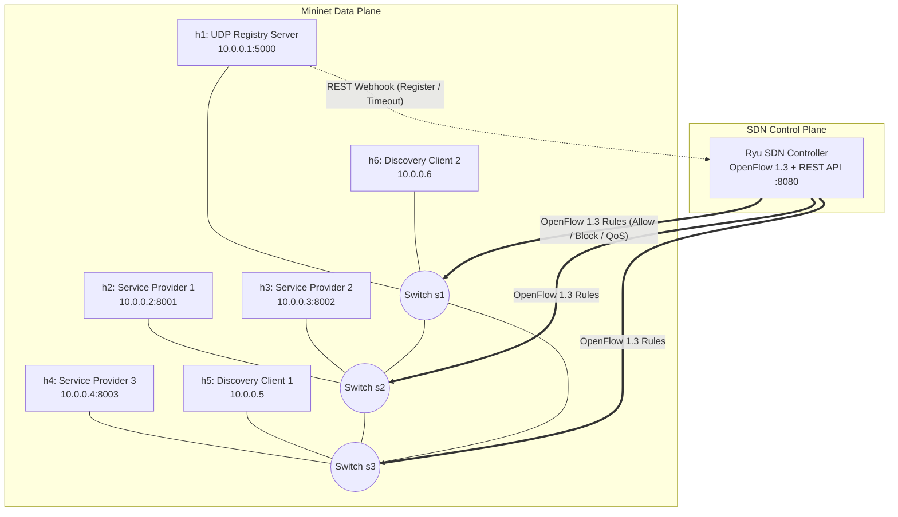
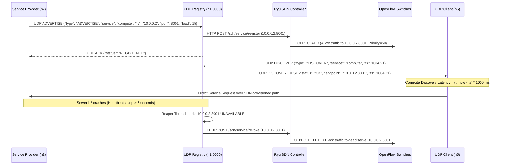

# SDN-Integrated UDP Service Discovery System

A low-level UDP socket-based Service Discovery and Registry application integrated with a dynamic Ryu SDN Controller inside a Mininet network topology.

## 1. Team Members & Module Ownership

| Team Member | GitHub Handle | Assigned Module & Responsibilities |
| :--- | :--- | :--- |
| **Naguru Kethan Kumar Reddy** | `@nagurukethankumarreddy-alt` | **UDP Registry & SDN Integration:** Multi-threaded UDP Registry (`SOCK_DGRAM`), thread-safe service dictionary, background heartbeat timeout reaper, and REST webhook triggers to the SDN controller (`app/protocol.py`, `app/registry_server.py`). |
| **Vedika** | `@vedika0303` | **Mininet Topology & Dynamic SDN Control:** Custom multi-switch Mininet topology and Ryu OpenFlow 1.3 controller for dynamic flow installation, dead-server flow revocation, load-aware routing, and UDP control-plane prioritization (`topology/mininet_topo.py`, `controller/sdn_controller.py`). |
| **Yashwant Kumar** | `@yashja06-lgtm` | **Service Advertisements, Discovery Client & Benchmarking:** Periodic UDP service beacons, dynamic runtime registration, client discovery with retry timeouts, high-precision latency measurement, and Baseline vs. SDN evaluation (`app/service_provider.py`, `app/discovery_client.py`, `evaluation/benchmark.py`). |

---

## 2. Problem Statement & Objectives
Develop a UDP-based service discovery application in which servers advertise their availability and clients discover suitable services through an SDN-controlled network:
- **Implement UDP service advertisements:** Servers periodically broadcast/unicast JSON-encoded UDP heartbeat beacons (`ADVERTISE`).
- **Maintain a service registry:** Central UDP registry tracks active service endpoints, load metrics, and TTL timestamps.
- **Support dynamic service registration:** New service providers can join or gracefully deregister (`DEREGISTER`) at runtime.
- **Discover available services:** Clients query the registry over UDP (`DISCOVER`) with timeout/retry resilience and receive the healthiest active server endpoint.
- **Handle service timeouts & Detect unavailable servers:** A background reaper thread detects missed heartbeats (`> 6.0s`) and purges unavailable servers.
- **Use SDN to control service traffic:** The Registry notifies the Ryu SDN controller upon service registration and timeout to dynamically install or revoke OpenFlow forwarding rules and prioritize UDP discovery traffic.
- **Measure discovery latency:** High-precision round-trip discovery latency (`time.perf_counter()`) is measured under normal, congested, and failure conditions.

---

## 3. System Architecture & Network Topology



---

## 4. Communication Flow & UDP Protocol Specification



---

## 5. Repository Structure

```text
sdn-udp-service-discovery/
├── app/
│   ├── protocol.py            # JSON UDP packet builders, parsers & constants
│   ├── registry_server.py     # Multi-threaded UDP Registry + timeout reaper + SDN trigger
│   ├── service_provider.py    # UDP advertisement daemon + dummy UDP service responder
│   └── discovery_client.py    # UDP client with socket timeouts, retry & latency tracker
├── controller/
│   └── sdn_controller.py      # Ryu OpenFlow 1.3 Controller + WSGI REST API for dynamic flows
├── topology/
│   └── mininet_topo.py        # Custom multi-switch Mininet topology script
├── evaluation/
│   └── benchmark.py           # Automated latency & failover evaluation + matplotlib plots
└── docs/
    └── test_cases.md          # Detailed D1 & D2 test cases and viva verification commands
```

---

## 6. Step-by-Step Instructions to Reproduce Results

### Prerequisites
- Ubuntu 20.04 / 22.04 VM with **Mininet**, **Open vSwitch**, **Python 3**, and **Ryu SDN Framework** (`pip install ryu requests matplotlib`).

### Step 1: Start the Ryu SDN Controller
```bash
ryu-manager controller/sdn_controller.py
```

### Step 2: Launch the Mininet Topology
In a new terminal:
```bash
sudo python3 topology/mininet_topo.py
```

### Step 3: Start the UDP Registry Server on `h1`
Inside the Mininet CLI (`mininet>`):
```bash
mininet> h1 python3 app/registry_server.py &
```

### Step 4: Start Dynamic Service Providers on `h2` and `h3`
```bash
mininet> h2 python3 app/service_provider.py --service compute --ip 10.0.0.2 --port 8001 --load 20 &
mininet> h3 python3 app/service_provider.py --service compute --ip 10.0.0.3 --port 8002 --load 50 &
```

### Step 5: Run Discovery Client & Measure Latency on `h5`
```bash
mininet> h5 python3 app/discovery_client.py --service compute --count 10
```

### Step 6: Verify Dynamic SDN Flow Rules
```bash
mininet> sh ovs-ofctl -O OpenFlow13 dump-flows s1
```

### Step 7: Test Server Timeout & Failover (Challenging Scenario)
Kill `h2`'s service provider and watch `h1` detect the timeout in 6 seconds, revoke `h2`'s OpenFlow rule via Ryu, and seamlessly route `h5` to `h3`:
```bash
mininet> h2 pkill -f service_provider.py
mininet> h5 python3 app/discovery_client.py --service compute --count 5
```
